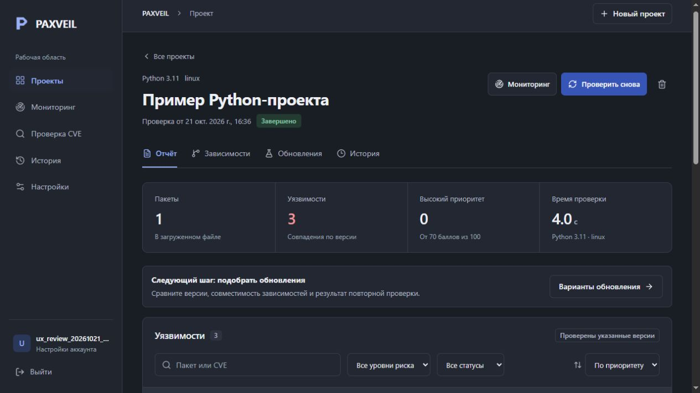

# PAXVEIL

[](https://github.com/mitsuhentti/paxveil/actions/workflows/ci.yml)

PAXVEIL checks Python dependencies, saves reports and compares update options. The Telegram bot and web app share an owner-scoped API and PostgreSQL database. Watch repeats checks, FixLab compares resolved versions, and Fire Drill searches saved inventories for a CVE.

[Try the bot](https://t.me/PAXVEIL_Bot) · [Русское руководство](docs/USER_GUIDE_RU.md) · [Current status](PROJECT_STATUS.md) · [Deployment](docs/DEPLOYMENT.md) · [Project case](docs/PORTFOLIO.md)



The selected deployment runs free of hosting charges on the owner's Windows computer. Telegram users need no access to that computer's browser UI. Polling requires outbound HTTPS; a domain, public IP address and incoming router ports are unnecessary. The bot is available while the computer, network and services are running. Around-the-clock availability is not guaranteed.

## Try a real check

Send `/start` to [@PAXVEIL_Bot](https://t.me/PAXVEIL_Bot), then `/example`. The example contains `requests==2.31.0`. Its button starts the normal scanner against current public sources and saves a project; no prepared vulnerability result is substituted. The package is never installed.

For your own project, send `requirements.txt`, `poetry.lock` or `uv.lock`. Use `/environment` to select Python and the operating system before uploading. Read `/privacy` before sending private package names. Reports show unavailable sources and uncertain versions.

## Features

- Manifest analysis up to 1 MiB and 300 dependency rows, with Python 3.9–3.14 and Linux, Windows or macOS markers.
- Saved reports, dependency inventory, known graph edges, finding status history, filtering and links to individual scans.
- Separate CVSS, dated EPSS and CISA KEV signals, advisory alias deduplication and explained priority factors.
- Three FixLab strategies. PyPI targets are validated, uv resolves binary metadata, and the proposed versions are queried in OSV again.
- Owner-scoped CVE checks and Watch subscriptions with categories, priority thresholds, quiet hours, timezone and digest settings.
- Telegram projects, report downloads, environment selection, account export and confirmation-bound deletion.
- Shared database request limits, account quotas, bounded report retention and public metadata cache.

The web interface has light/dark themes and responsive navigation. On 21 October, 20 real-browser checks covered sample selection/cancellation, a completed scan, filters, FixLab navigation/reload recovery, historical scan links and return to the latest report. They also covered owner-specific settings drafts across navigation, inline quiet-hour errors with focus, saved settings, a mobile layout without overflow and menu focus/resize behavior. See [usability evidence and screenshots](docs/USABILITY_VALIDATION.json) and [design review](docs/DESIGN_REVIEW.md).

## Run locally

Use PowerShell 7, Python 3.11, Node.js 24/npm and PostgreSQL 18. For a fresh checkout:

```powershell
.\scripts\init.ps1
.\scripts\start.ps1 -Telegram
```

Store the BotFather token only in `TELEGRAM_BOT_TOKEN` in the ignored local `.env`. Keep `PAXVEIL_BOT_KEY` independent. Do not overwrite an existing environment file. Open [the web app](http://localhost:3000) on the host computer.

This development workspace already has an external runtime. From `outputs/paxveil`, use its matching path:

```powershell
.\scripts\stop.ps1 -RuntimeDirectory '..\..\work\runtime'
.\scripts\start.ps1 -Telegram -RuntimeDirectory '..\..\work\runtime'
```

Keep one runtime and one polling instance. Startup checks ports and recorded process identities. The user-level supervisor supports restart after a component fails, Windows sign-in startup and daily private backups with seven-day rotation. Manual sleep, sign-out, shutdown or lost connectivity can interrupt service. [Deployment](docs/DEPLOYMENT.md) covers enable/disable, bot-only operation, updates and restore checks. The complete fresh-machine bootstrap remains unverified. Docker images and the private Compose API/worker stack passed remote CI.

## Evidence

On **21 October 2026**, the backend suite completed with **178 passed, 2 intentional external-source skips and one Starlette/httpx warning** in 46.75 seconds. TypeScript and the production frontend build passed.

The real PostgreSQL check used eight threads: 24 enqueue attempts produced one job; 24 pending jobs received 24 distinct claims. Lease recovery, stale-worker fencing, account deletion races and concurrent catalog ingestion passed. A shared request counter accepted exactly 11 of 64 attempts and recovered in the next window.

The native supervisor checker also passed all 19 checks on 21 October. In the browser, a new sample project completed in about four seconds with three findings and five source entries. Balanced and Maximum Coverage proposed requests 2.34.2 and returned zero known findings for the proposal; Minimal Change reported insufficient data. Those results are dated observations, not a compatibility guarantee.

Earlier live analysis of five pinned dependencies returned 12 deduplicated findings. Balanced and Maximum Coverage resolved five pins whose subsequent OSV checks returned zero known findings. These dated observations do not establish application compatibility. A fresh private backup restored on 21 October with all fingerprints matching across 20 tables and 251 rows; the archive was 87,355 bytes. Current inspection confirmed EFS protection of the selected runtime data, logs, private backups and secret file on this Windows machine.

The official Telegram API identified @PAXVEIL_Bot at 13:54:43 UTC on 21 October, verified all 12 commands in default/Russian lists and confirmed no webhook. An earlier connection failure recovered; these are point-in-time checks, not continuous availability evidence. The owner's `/start`, `/privacy`, `/environment` and `/projects` confirmations remain dated to the earlier client checks. Telegram-client upload, report, FixLab, linking and Watch acceptance remain separate work. Source is published on [GitHub](https://github.com/mitsuhentti/paxveil). Backend, frontend and container checks passed [GitHub Actions](https://github.com/mitsuhentti/paxveil/actions/workflows/ci.yml) on 21 October.

[Tests](docs/TEST_RESULTS.md) · [Current runtime](docs/CURRENT_RUNTIME_VALIDATION.json) · [PostgreSQL evidence](docs/POSTGRES_CONCURRENCY_VALIDATION.json) · [Supervisor](docs/NATIVE_SUPERVISOR_VALIDATION.json) · [Backup evidence](docs/BACKUP_VALIDATION.json) · [Live source results](docs/CORE_VALIDATION.json) · [Operations](docs/OPERATIONS_VALIDATION.md)

## Scope and source

A manifest may omit installed transitives or root constraints. FixLab targets x86_64 wheel metadata; it never builds uploaded code or tests application behavior. A vulnerable version alone does not establish exploitability. Source failure remains visible, and no known findings is not a guarantee of security. Watch requires a running worker and network.

`backend/paxveil` contains API, worker, ETL, CLI and bot; `frontend` contains Next.js/React; `backend/migrations` contains the PostgreSQL schema and analytical views. `scripts`, `compose.yaml` and `.github/workflows` contain operations and executable CI.

[Architecture](docs/ARCHITECTURE.md) · [Core](docs/CORE.md) · [API contract](docs/CONTRACT.md) · [Public limits](docs/PUBLIC_RESOURCES.md) · [Cache](docs/PUBLIC_CACHE.md)

Secrets, user data, installed dependencies and runtime files are excluded from Git. Final publication review is separate from choosing a license; no open-source license is currently included.
