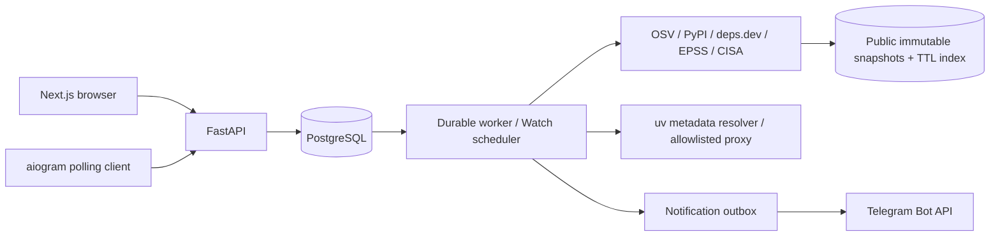

# Architecture

PAXVEIL is a local-first, account-scoped dependency intelligence service. Next.js serves the Russian interface; FastAPI handles authentication and object access; PostgreSQL retains project files, normalized package/version relations, scan history, advisory metadata, finding status, FixLab scenarios, subscriptions, queue leases and notification delivery records. Telegram is a second client of the same authenticated API.

## Data boundaries

Uploaded manifests are bounded UTF-8 bytes stored in the database. Filenames are matched against three exact supported names, never used to construct filesystem paths. Parsers retain uncertain/unpinned/unsupported requirements without claiming a version check. Project Python/platform markers are evaluated explicitly; absent manifests can leave dependency roots unknown. A flat requirements file does not establish a complete transitive graph. PyPI metadata edges are matched only to actual uploaded pins. deps.dev is an independent metadata cross-check, not evidence for the uploaded project's resolved environment.

External destinations are fixed by source clients, with redirect rejection, response bounds, retry/backoff and per-host pacing. Source snapshots use a content-addressed SQLite cache containing public API payloads only; PostgreSQL scan source rows retain hashes/timestamps for provenance. API failures remain visible and cannot be converted into clean reports.

## Durable processing

API requests enqueue scan/FixLab jobs. A separate worker leases rows via PostgreSQL `FOR UPDATE SKIP LOCKED`, bounds each job to ten minutes, fences expired claims with random claim tokens and retries failures at most three times. A project row lock serializes concurrent scan enqueue requests. Worker restarts preserve pending jobs; expired running jobs become retryable after a fifteen-minute lease. Watch enqueues exact saved file scans every six hours by default. API availability does not depend on scan duration.

The worker stages JSON reports plus normalized operational rows in one transaction. The latest known advisory record is retained separately from immutable scan reports. SQL views aggregate scan risk and delivery metrics; `python -m paxveil.etl quality` runs concrete integrity checks. Airflow/dbt are not required for this scale; a future orchestrator can invoke these existing jobs without replacing core processing.

## Identity

Passwords use PBKDF2-SHA256 with random salts and 600,000 iterations. Session tokens contain 256 bits of randomness; only hashes are stored. Browser cookies are HttpOnly/SameSite=Lax; production TLS must enable Secure. All entity queries enforce the authenticated owner, including jobs, scans and Fire Drill. Foreign object IDs return 404.

The bot authenticates its machine channel using an ignored local service key, then obtains owner sessions keyed to Telegram sender IDs. Linking uses a hashed, one-use, ten-minute code generated by the signed-in web account. Only a Telegram-only account can merge into a web account; an existing web owner cannot be displaced. Old Telegram-only sessions are removed on merge.

## Risk and remediation

CVSS represents technical severity; EPSS is a separate dated exploitation probability. CISA KEV signals known exploitation in the catalogue, not proof of exploitation in the user's application. Priority includes an explanation for each factor and remains a triage heuristic. Aliased advisories are deduplicated.

FixLab validates target releases on PyPI, applies strategy-specific version bounds, resolves wheel metadata using uv with builds/interpreter downloads disabled, then actually queries OSV for the proposed resolved versions. A dedicated CONNECT proxy allows only official PyPI hosts; malicious transitive URLs cannot access arbitrary destinations. No package is installed and no project code/tests run. Output includes conflicts, graph/version changes and uncertainty. Without enough root/metadata information a strategy reports insufficient data.

## Notifications

Initial scans establish a baseline. Watched subsequent scans compare advisory identity and meaningful priority/fix/KEV changes; manual finding status changes emit status events. Fingerprints prevent duplicate outbox events. Delivery rechecks current subscription, category and threshold, observes IANA-zone quiet hours, groups daily digest events by owner and records Telegram acknowledgements. Transient failures retry; permanent failures remain visible.

Telegram's sendMessage API offers no idempotency key. If the service crashes after Telegram accepts a message but before the database records acknowledgement, a duplicate delivery is possible. The outbox prevents ordinary repeated sends; it does not claim exactly-once external delivery.

## Deployment boundaries

Native local processes are verified. Compose is a reproducible Linux topology with an initial migration job, nonroot app containers, dropped capabilities, private database network, persistent data/cache volumes and loopback published ports. Docker execution is not verified on this machine. Public deployment additionally requires TLS, explicit origins, secure cookies, backups, secret management, per-account quotas and a deliberate public-registration policy.
